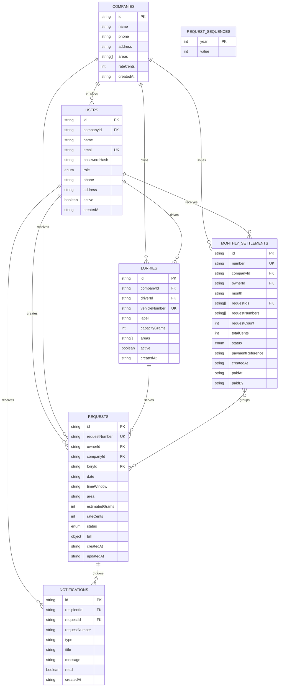

# TeaCollector database design

TeaCollector uses MongoDB through Mongoose. Each document has a business key named `id` (a UUID string); Mongoose's `_id` is also present internally, but application relationships use the UUID fields below. Timestamps are ISO 8601 strings because the current API serializes them as strings.

## ERD

The `REQUEST_SEQUENCES` collection is an internal counter rather than a business entity. It guarantees unique, readable request numbers such as `TC-2026-0001`.

## Collections and fields

### `users`

| Field | Type | Key/constraint | Purpose |
| --- | --- | --- | --- |
| `id` | String | Primary, unique | Application user identifier |
| `companyId` | String | Foreign key to `companies.id`, indexed | Set for company users and collectors |
| `name`, `phone`, `address` | String | Required except address | Contact details |
| `email` | String | Unique, lowercase | Login identity |
| `passwordHash` | String | Required, hidden by default | Password credential hash |
| `role` | Enum | `owner`, `company`, `collector` | Authorization role |
| `active` | Boolean | Default `true` | Whether sign-in/assignment is allowed |
| `createdAt` | String | ISO timestamp | Audit timestamp |

### `companies`

`id` is the primary key. `areas` is a String array of served collection areas, and `rateCents` is an integer monetary amount in LKR cents. A company has many users, lorries, requests, and settlements.

### `lorries`

`id` is the primary key; `vehicleNumber` is unique and normalized to uppercase. `companyId` references the owning company, `driverId` references a collector in that company, and `capacityGrams` is an integer. `areas` stores the areas the vehicle accepts, while `active` controls new bookings.

### `requests`

`id` and `requestNumber` are unique keys. `ownerId`, `companyId`, and `lorryId` reference the parties involved. `estimatedGrams`, bill weights, and monetary fields are integers to avoid floating-point errors. `status` is the collection lifecycle enum: `pending`, `accepted`, `assigned`, `on_the_way`, `collected`, `completed`, `paid`, `rejected`, or `cancelled` (plus legacy `requested`).

The embedded `bill` subdocument contains measured weights, rate, total, payment status, and payment audit fields. It is embedded because a bill belongs to exactly one request and is read and updated with that request.

### `notifications`

`recipientId` is indexed and references `users.id`; `requestId` optionally references `requests.id`. Notifications are append-only messages with a Boolean `read` flag.

### `monthly_settlements`

`id` and human-readable `number` are unique. `companyId` and `ownerId` reference the settlement parties. `requestIds` stores the grouped request UUIDs; `requestNumbers` is a display snapshot. The compound unique index `(companyId, ownerId, month)` prevents duplicate monthly settlements.

### `request_sequences`

`year` is the unique key and `value` is the atomic counter used to allocate request numbers.

## Indexes and integrity

- Unique: `users.email`, `lorries.vehicleNumber`, `requests.requestNumber`, `monthly_settlements.number`, and entity `id` fields.
- Foreign keys are enforced in application logic because MongoDB relationships are represented by String UUIDs rather than `ObjectId` references.
- Query indexes: `users.companyId`, `lorries.companyId`, `requests.ownerId`, `requests.companyId`, `requests.lorryId`, `notifications.recipientId`, and `notifications(recipientId, createdAt desc)`.
- Operational index: `requests(lorryId, date, status)` supports capacity and booking checks.
- `strict: "throw"` rejects fields not described by the schemas; enum and minimum constraints protect valid types and ranges.

Source of truth: the schemas in `backend/models/` and the model registry in `backend/models/workflowModels.js`.
